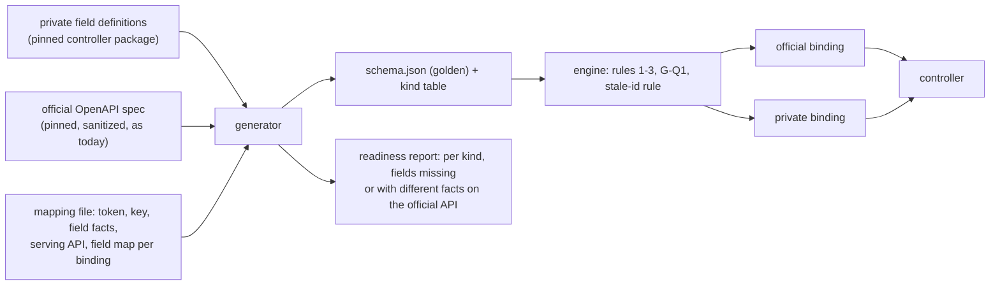

# One UniFi Pulumi provider over two APIs: the frame

**Status:** agreed frame (revision 4); all four owner questions answered 2026-11-26. **Where am I:** **Domain → System** (frame) → Service (skipped: one plugin) → Module (next gate) → Interfaces → Implementation.
**Next:** model-source discovery (§4, before the tracer), then the module-layer gate.

**What changed since your last look:** stored ids name their API, so a move is safe without a refresh; a move needs every field to behave the same on both APIs; Q4 asks whether "gaps" means kinds or fields; the day-one official count is stated.

## 1. Today, and what removes each failure

A downstream program reaches the controller through the Terraform provider (ubiquiti-community 0.65)
and Pulumi's bridge, and works around these classes:

| | Failure class | Cause | Removed by |
|---|---|---|---|
| F1 | A setting can be switched on from code but never off; removing it from code leaves it on | on/off is two fields; "off" reads back as "not declared"; a dropped input means "keep" | rules 1 and 2 |
| F2 | An object the controller holds cannot be adopted (port profiles, #496) | stored values validated more strictly than the controller does | rule 1 |
| F3 | Unnamed objects get invented names | the bridge's auto-naming | no auto-naming |
| F4 | Controller-held secrets need `ignore_changes`, and land in state | no way to say "not my secret" | secrets left out are never read into state |
| F5 | An update overwrites fields never set (#544, fixed per resource across #680 to #689) | bodies built from defaults or stale state | rule 2 |
| F6 | Adoption needs the controller's internal id | the id is the identity | rule 3 |
| F7 | Kinds with no resource (traffic rules, DHCP options) | each kind hand-written | generated from definitions; the 12 v2 kinds without shipped definitions are hand-written data; a completeness report lists gaps |

**Requirements:** none from the owner.

**Answered guidance (owner, 2026-11-26):**
- **G-Q1** "A": a managed field removed from code resets to off or the controller default.
- **G-Q2** "C": UniFi-shaped resources made correct now; domain-shaped components later, in a separate package.
- **G-Q4** "A": whole kinds for now; revisit after the tracer measures whether an official PUT resets fields it does not carry.
- **G-Q3** "A": "One provider, which uses the official OpenAI [OpenAPI] spec where possible but falls back to unofficial api sources to fill in the gaps. As the official spec gains features, parts of the provider migrate to it".

**Earlier guidance:** "the most robust/killer pulumi module" (2026-11-25); "all of unifi should be represented ... i shouldnt need to open the unifi dashboard anymore" (2026-11-21).

**Constraints:** the Integration API cannot write clients, port forwards, WAN, dynamic DNS, BGP, WireGuard, RADIUS, rate limits or port profiles (checked to 11.0.97); the private API has no published spec; this repo is public.

| Goal | Delivered by |
|---|---|
| The failure classes cannot occur | rules 1-3, held once in the engine for both APIs; the tracer proves them on each |
| All of UniFi represented | the private API fills every gap; the kind table in §3 |
| Official spec where possible; migrate as it grows (G-Q3) | bindings, readiness report, Q4 (§3) |
| Domain-shaped components later (G-Q2) | deferred to a separate package |
| Replace the Terraform provider downstream (from the brief) | the switch path in §4, a separate effort |

## 2. The domain model

The provider's context is **the controller's objects as declared state**; which API carries a kind is
a binding, invisible in the public surface.

```ts
/** One sort of controller object. One public model, whichever API serves it. */
interface Kind {
  token: string;                       // names no API and no API version: a move between APIs never renames it
  naturalKey: string[];                // field paths that find one object: ["mac"], ["name"], ["key", "record_type"]
  fields: Record<FieldPath, Field>;    // the public field facts (below)
  serving: "official" | "private";     // the API that serves this kind (mapping file; Q4 may make this per field)
}

/** The public facts of one field. Each binding also states them for its API. A kind may move to an API
 *  only when every field exists there WITH THE SAME FACTS, or a move could turn an update into a replace. */
interface Field {
  secret: boolean;                     // fails closed: secret unless the mapping file clears it
  readOnly: boolean;                   // computed by the controller
  createOnly: boolean;                 // a change means replace
  notReturned: boolean;                // written but never read back: no drift possible
  off?: OffEncoding;                   // how the field says "off"
  default?: Value;                     // what a dropped field resets to (G-Q1). From the private definitions or
                                       // the mapping file, never guessed from the spec, which has few defaults.
                                       // With no off and no default, a dropped field is an error until declared.
  replacedWhole: boolean;              // nested object or list replaced on every write
}

/** Derived from saved old inputs vs new inputs (no separate store). Refresh returns inputs only for managed paths.
 *  After import: managed = the natural key + the fields in the import's `properties` list. */
type Management =
  | "not-managed"                      // never sent, never diffed, a secret never stored
  | { managed: Value }                 // sent; drift shown
  | { managed: "off" }                 // reads back as off
  | "dropped";                         // reset to off or the default (G-Q1)

/** The stored Pulumi ID. A MAC kind's ID is the MAC on either API. Every other ID names its API, so no
 *  binding is ever handed the other API's id. */
type StoredId = `mac:${string}` | `official:${string}` | `private:${string}`;
```

| Concept | Rule (design choice) |
|---|---|
| Identity | Import and lookup use the natural key. No match, several matches or an empty key is an error naming the candidates. |
| Stale id | Before any operation (read, diff, update, delete), a stored id naming an API other than the serving one is re-resolved by natural key, and Read stores the new one. "Not found" means gone only for an id of the serving API that its natural key also fails to find. |
| Site | `siteId` (the existing name) takes the site's short name (default `default`) or its UUID. The provider resolves the other form: the private API uses the short name, the official API the UUID, linked by the official site's `internalReference` (a tracer check). |
| Deleting | Pulumi's `retainOnDelete` and `import` cover keeping and adopting. The controller's per-object refusal (built-ins) turns a delete into a release, with a warning. |
| Validation | Only declared values are checked, against the controller's definitions; values read back are never rejected. |

Why: Pulumi sends the stored id to Update and Delete (`step.go` 592, 650, 961, v3.230.0) and takes a new one only from Read (1538-1546). `RefreshBeforeUpdate` (`deployment_executor.go` 174-180) was not chosen: it refreshes every resource on every `up`, and works only if the flag was saved before the move.

## 3. The system shape: one engine, two bindings



**Day one (pinned 10.4.57 spec against ubiquiti-community/go-unifi's private fields):**

| Kind | Official fields | Private fields | Same-facts complete? |
|---|---|---|---|
| Networks | ~26 | ~270 (DHCP, IP aliases, ...) | no |
| Wi-Fi | ~35 | ~110 | no |
| Firewall policies | 12 | ~20 (ICMP types, ordering index, ...) | no |
| DNS records | 6 types (A, AAAA, CNAME, MX, SRV, TXT) | also NS, PTR, SOA | no |
| Firewall zones | name, networks | name, networks (+ computed) | likely, pending a facts check and the live tier |
| ACL rules | yes | no private definition | official (official-only) |

So **about two of roughly 40 kinds** are official on day one if a whole kind moves at once.

**Q4 (answered 2026-11-26: A, general guidance). When the official API covers only part of a kind, should that kind still use it for those fields?**

Your note says "fill in the gaps"; the gaps can be whole kinds or single fields.

| | A. Whole kinds (recommended for now) | B. Single fields |
|---|---|---|
| Day one | about 2 kinds official | about 7 kinds partly official (networks, Wi-Fi, policies, zones, DNS, ACL rules, traffic lists) |
| One update | one API call | two calls to two APIs, which can half-succeed |
| Depends on | nothing open | the official full PUT leaving the fields it does not carry untouched: unknown, a tracer check |
| Later | moving to B changes no token or input, so it can follow the evidence | — |

Your answer sets the `serving` choice: per kind or per field.

| Part | Call | Cost |
|---|---|---|
| Moving kinds | each spec bump regenerates the readiness report; a kind at zero flips in the mapping file and is proven on Tier 2 | delivers "parts of the provider migrate to it" with no replace or rename |
| pulschema | replaced as the generator: the spec is read into the same Kind model. Kept: the spec pin, `SanitizeSpecBytes`, `FixOpenAPIDoc`. Discriminators become a field the binding maps. | the 21 working official resources are rebuilt; per-variant tokens go |
| Rules on both | the engine holds rules 1-3, G-Q1 and the stale-id rule. A binding only reads, writes a body merged onto a fresh read, and deletes. Encodings are data. | two bindings to keep generated |
| Library | ubiquiti-community/go-unifi (MPL-2.0) is the private reference; its ~580 lines of per-kind wire patches size the mapping file | a large mapping file |
| Auth | one `apiKey` (X-API-Key) for both; private writes with a key are tracer step 1; a login only if refused | — |
| Version | one controller version per release, first 10.4.57 (the test image); configure fails on others | a console upgrade waits on a release |
| Contract | `api-contract.md` kept and rebased: API-neutral token modules; config names `apiKey`, `apiHost`, `siteId`, `allowInsecure` kept | one breaking rebase before the first release |
| Tests | Tier 1 (CI): determinism, golden, Prism request shapes for the official binding. Tier 2 (local, UniFi OS Server image): judges every rule on both bindings | Tier 2 stays local |

## 4. Design rules (design choices), costs, next

1. **Every managed path round-trips, on either API.** `notReturned` fields are the named exception.
2. **An update changes only managed paths;** a dropped path resets (G-Q1).
3. **No one names a controller id, no token names an API, and no binding receives the other API's id.**

**Costs:** two definition sources and bindings; the official resources rebuilt; about 2 official kinds on day one under A; a large mapping file; last writer wins; trimming generated import code resets the trimmed fields unless `import` with `properties` is used.

**Downstream switch path:** the package is `pulumi_unifi`, the bridged SDK's own name, so the swap is one change. Tokens change (from `unifi:index/client:Client`), so state is re-imported by natural key: about 200 objects, one file, no ids.

**Discovery first: where the private model comes from** (owner, 2026-11-26: "The most important discovery item: can we reliably get/build a model of the internal API? Ideally we could extract/scrape it from the official build that UniFi publishes, since that gives us a versioned target to test against").

| Source (official, versioned) | Gives | Status |
|---|---|---|
| UniFi OS Server installer (`fw-update.ubnt.com`, product `unifi-os-server`; 5.1.15 = Network 10.4.57, 875 MB) | `api/fields/*.json` inside the Network jar, **and** a runnable UniFi OS (the only kind that serves the Integration API) | preferred; probe pending (layout, Docker run, v2 routes) |
| Network app `.deb` (`dl.ui.com/unifi/<v>/unifi_sysvinit_all.deb`; 10.4.57 = 130 MB) | `api/fields/*.json` only (go-unifi's source; it pins 10.6.109) | fallback |
| Neither | the newer kinds (go-unifi hand-writes 9) and the 12 v2 kinds | gap; the probe looks for routes in the jar and web UI |

Findings land in `docs/research/private-api-model-source.md`. Ubiquiti's files are never committed.

**Tracer:** against the test image.
- **Client** (private): a key writes; override and fixed IP created, set off and dropped all round-trip; a name-only update keeps the override; a controller-UI edit shows drift only on managed fields; import by MAC with `properties` plans nothing.
- **Network on both APIs** (test-only flip, fields both carry): created privately and flipped to official; then `up` **without refresh** re-resolves it, with no replace and nothing dropped from state; refresh stores the new id with no diff; then update, rename and drop a field through the official API.
- **Checks:** do the two APIs' ids match; the site's `internalReference`; per API, does an update merge or replace, and does an official PUT reset fields it does not carry (Q4); are re-sent stored values rejected; two stacks adopting one object; deleting the built-in default network.
- **Non-goals:** secrets, v2 kinds, release, the switch.

**Outline:** (0) model-source discovery; (1) tracer; (2) engine: secrets, deletability, hooks; (3) coverage and the readiness report; (4) official bindings for ready kinds, retiring the pulschema runtime; (5) contract rebase, semantic-release.

---
History: 2026-11-25 draft, revision 2; 2026-11-26 revision 3 (owner's answers: one provider over two APIs), revision 4 (named ids, same-facts readiness, Q4); Q4 answered A; model-source discovery added as step 0.
